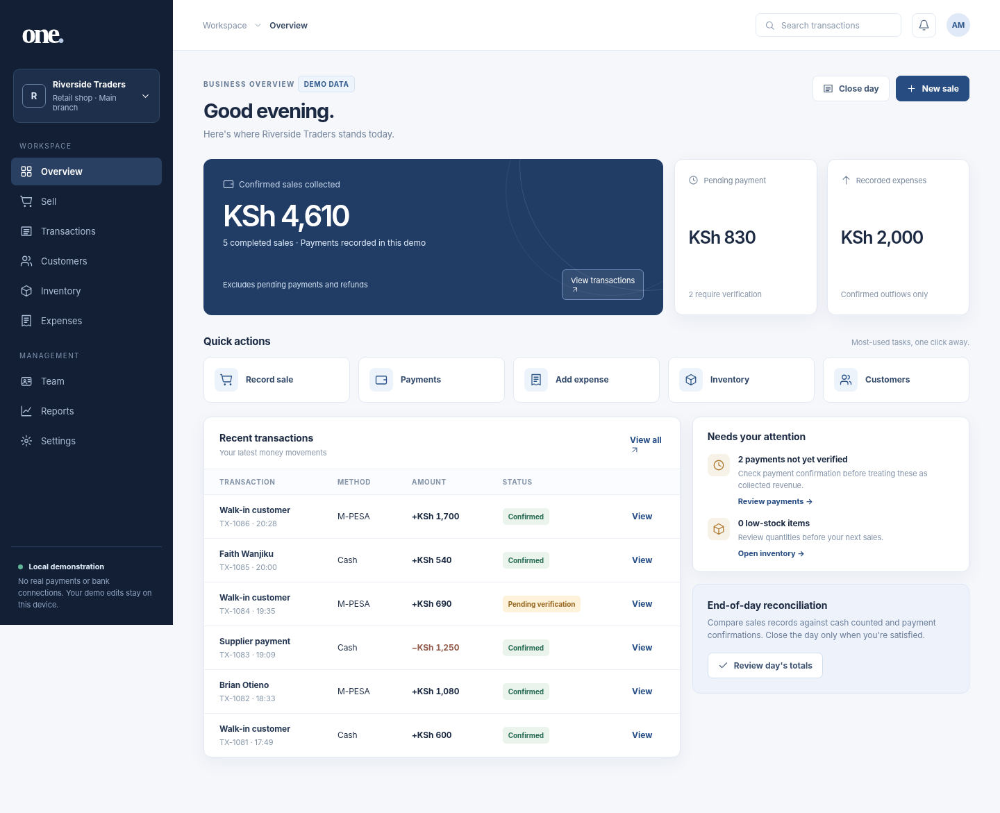
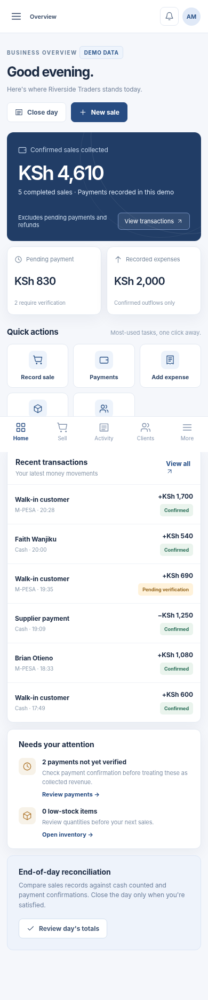

# ONE · Business Management

Approved direction: professional, mature, M-PESA-informed management experience. Final colour choice **Deep Navy**, not Charcoal/Emerald. Includes transactions, sales, customers, staff, business templates, inventory and a simulated payment workflow. Real payment integrations were never activated.

[Open the approved Deep Navy interactive demo](./one-deep-navy.html). This is a public-safe, local-only prototype using fictional sample data, not a real M-PESA connection or production database. Desktop and mobile previews are included below.

The prototype routes on the URL hash, so the studio project page can launch a specific screen:

| Screen | URL |
| --- | --- |
| Overview | `./one-deep-navy.html#overview` |
| Sell | `./one-deep-navy.html#sell` |
| Transactions | `./one-deep-navy.html#activity` |
| Customers | `./one-deep-navy.html#customers` |
| Inventory | `./one-deep-navy.html#inventory` |
| Expenses | `./one-deep-navy.html#expenses` |
| Team | `./one-deep-navy.html#team` |
| Reports | `./one-deep-navy.html#reports` |
| Settings | `./one-deep-navy.html#settings` |

Demo edits are stored in this browser's local storage only.

